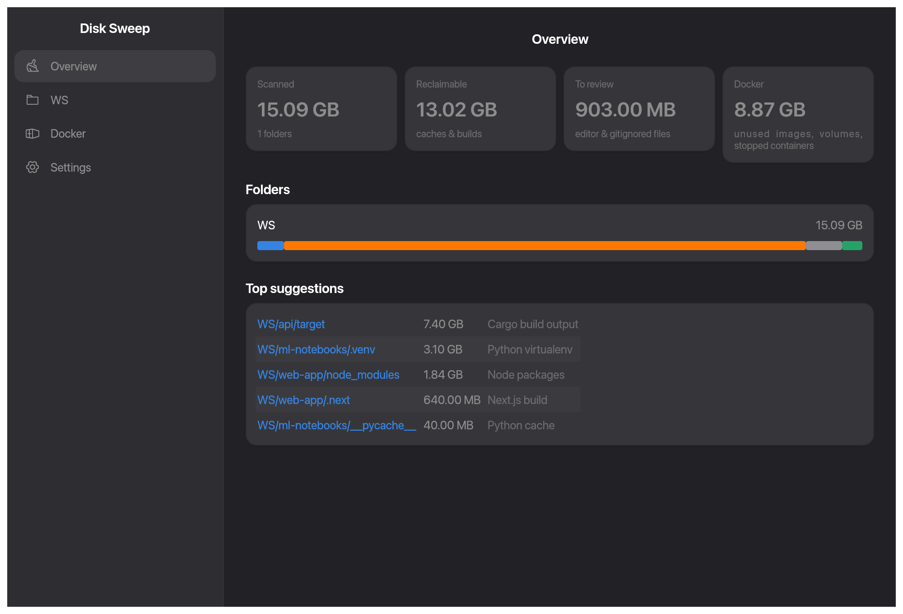

# Resources for Mac

Two macOS apps written in Rust with [egui](https://github.com/emilk/egui), in the style of [GNOME Resources](https://apps.gnome.org/Resources/): **Resources**, a system monitor, and **[Disk Sweep](#disk-sweep)**, which frees space your projects can rebuild. They share one look and are released together.

Website: **[resources.vachagan.dev](https://resources.vachagan.dev)**


- **Overview** (main page): every app as a bubble around "This Mac" (processor and memory rings), sized by memory or processor, its processes packed inside, ring coloured by load; lines show which app launched which. Pan, pinch to zoom, double-click a bubble for that app's process tree; End / Kill / Halt / Continue from the bottom bar
- **Menu bar:** chosen stats (`CPU 23% · MEM 61%`) with a menu of all current values; closing the window keeps Resources running there
- **Desktop widget:** a small window below your other windows with live graphs of chosen stats; drag it anywhere
- **Settings:** pick the stats for the menu bar and the widget, with suggestions based on what your Mac is doing right now
- **Apps:** running apps with their Dock icons and combined CPU and memory across their processes; a System Processes row for the rest; End / Kill / Halt / Continue
- **Processes:** searchable, sortable list with app icons; End (SIGTERM) / Kill (SIGKILL) / Halt (SIGSTOP) / Continue (SIGCONT)
- **Processor:** total and per-core usage
- **Memory:** RAM and swap
- **GPU:** Apple Silicon usage and memory in use
- **Drives:** one entry per drive with read/write speed and totals
- **Network:** one entry per connection (Wi-Fi, Ethernet); system VPN tunnels merged into one entry
- **Battery:** charge, power draw, health, design capacity, cycle count

The GPU and Battery pages appear only on Macs that report them.

## Screenshots

| | |
|---|---|
|  |  |
|  |  |
|  |  |
|  |  |
|  |  |

Every page in light and dark mode is in [`docs/screenshots/`](docs/screenshots). They are rendered from sample data with `cargo test -p resources-mac --test screenshots -- --ignored`, so re-running it updates them after UI changes.

## Disk Sweep

A second app in this repo (`crates/disk-sweep`): pick folders such as `~/WS`, see where the bytes are, and move what is safe to the Trash. It tells **project files** apart from **caches & builds** (`node_modules`, `target`, `.venv`, `__pycache__`, `.next`, …), **editor & OS metadata** (`.idea`, `.vscode`, `.DS_Store`), **other gitignored files** and **git history**, following each repo's `.gitignore`. A Docker page shows images, containers, volumes and build cache with what `docker … prune` would reclaim, and the real size of the Docker Desktop VM disk.



Folders go to the Trash, so you can put them back, and nothing moves before a dialog shows how many items and how much space. Folders with generic names such as `build`, `dist` or `vendor` are suggested only when `.gitignore` ignores them. Symbolic links are never followed. Screenshots of every page are in [`docs/screenshots/disk-sweep/`](docs/screenshots/disk-sweep).

Resources links to it: each drive page has **Free Up Space…**, shown when `Disk Sweep.app` is in Applications, Disk Sweep is built next to Resources (`cargo build --release`), or `disk-sweep` is on your `PATH`.

## Install

```sh
brew install --cask VachaganGrigoryan/tap/resources-mac
brew install --cask VachaganGrigoryan/tap/disk-sweep
```

Or download `resources-mac-<version>.dmg` and `disk-sweep-<version>.dmg` from [Releases](https://github.com/VachaganGrigoryan/resources-mac/releases) and drag each app to Applications.

Requires macOS 13 or later. Both apps are universal (Apple Silicon and Intel).

**First launch:** releases are not notarized, so macOS blocks each app the first time. Open **System Settings → Privacy & Security**, scroll down and click **Open Anyway**. Alternatively, run:

```sh
xattr -dr com.apple.quarantine /Applications/Resources.app
xattr -dr com.apple.quarantine "/Applications/Disk Sweep.app"
```

## Build from source

```sh
cargo run -p resources-mac --release
cargo run -p disk-sweep --release
```

The repository is one Cargo workspace:

| Path | What it is |
|---|---|
| `crates/ui` | `resources-ui`: the shared theme, icons, widgets, window shell (sidebar, header, page column), confirm dialog and UI test helpers |
| `crates/resources` | `resources-mac`: the Resources app |
| `crates/disk-sweep` | `disk-sweep`: the Disk Sweep app; depends on `resources-ui` only |
| `site` | the website, a separate Cargo project |

Quality gate (same as CI):

```sh
cargo fmt --check && cargo clippy --workspace --all-targets --all-features -- -D warnings && cargo test --workspace
```

Both app icons are drawn in code; to regenerate each crate's `macos/AppIcon.icns`, `assets/icon-256.png` and the PNGs in `docs/` after changing `scripts/icon.swift`:

```sh
swift scripts/icon.swift
```

To regenerate the screenshots in `docs/screenshots/` (every page, light and dark, from sample data) and the demo frames in `target/demo/`:

```sh
cargo test -p resources-mac --test screenshots -- --ignored
cargo test -p disk-sweep --test screenshots -- --ignored   # docs/screenshots/disk-sweep/
```

Encode the demo frames into `docs/screenrecord/` (mp4 for the website, GIF for this README):

```sh
ffmpeg -framerate 15 -i target/demo/%04d.png -vf scale=1200:-2 -c:v libx264 -pix_fmt yuv420p -movflags +faststart docs/screenrecord/resources-mac-demo.mp4
ffmpeg -framerate 15 -i target/demo/%04d.png -vf "fps=12,scale=900:-1:flags=lanczos,split[a][b];[a]palettegen[p];[b][p]paletteuse" docs/screenrecord/resources-mac-demo.gif
```

To build both universal apps and dmgs locally:

```sh
rustup target add aarch64-apple-darwin x86_64-apple-darwin
cargo build --release --target aarch64-apple-darwin
cargo build --release --target x86_64-apple-darwin
scripts/bundle.sh 0.1.0   # → dist/{Resources,Disk Sweep}.app, dist/{resources-mac,disk-sweep}-0.1.0.dmg
```

## Releasing

1. Bump `version` under `[workspace.package]` in the root `Cargo.toml` (one version for both apps) and commit.
2. `git tag v0.1.0 && git push --tags`.
3. The **Release** workflow builds both universal dmgs, attaches them to a draft GitHub release and updates both casks in [`homebrew-tap`](https://github.com/VachaganGrigoryan/homebrew-tap). This needs the repository secret `HOMEBREW_TAP_DEPLOY_KEY`: the private half of an SSH deploy key that has write access to `homebrew-tap` only.
4. Publish the draft release. The cask URL works only after the release is published.

## Website

The website ([resources.vachagan.dev](https://resources.vachagan.dev)) lives in [`site/`](site): a home page for both apps plus `/resources/` and `/disk-sweep/`, served by a small Rust (axum) server from `site/static/` with the screenshots and icons in `docs/`. Its tests fail when a page references a missing screenshot or icon. Preview it with `docker build -f site/Dockerfile -t resources-site . && docker run --rm -p 8080:8080 resources-site`. Vercel deploys `site/static/` and the screenshots from `main` as static files (see `vercel.json`). The old self-hosted deploy (`.github/workflows/deploy-site.yml` with `deploy/zimaos/compose.yaml`) is kept but stopped: the workflow is disabled in GitHub Actions; enable it there to bring it back.

## Limitations

- Processes owned by other users (e.g. root) can't be ended. The app does not ask for administrator rights.
- GPU statistics come from undocumented IOKit keys and may change in future macOS versions.

## Credits and license

Inspired by [GNOME Resources](https://gitlab.gnome.org/GNOME/Incubator/resources) by nokyan and contributors. This is an independent project: it is not affiliated with or endorsed by GNOME, and is written from scratch (only the graph colour values and page layout follow GNOME Resources). Mac and macOS are trademarks of Apple Inc.

Icons: [Phosphor](https://phosphoricons.com/) (MIT, see `crates/ui/assets/fonts/Phosphor-LICENSE`).

Licensed under the [Apache License 2.0](LICENSE); see [NOTICE](NOTICE) for bundled third-party works. Release builds also carry `THIRD_PARTY_LICENSES.html` with the license of every compiled-in crate (`cargo about generate about.hbs` produces it). Releases up to and including 0.3.0 were published under GPL-3.0-or-later.

Contributions are welcome, see [CONTRIBUTING.md](CONTRIBUTING.md).
