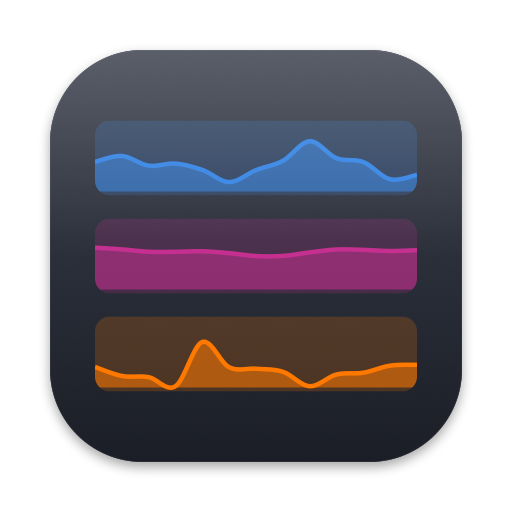

# Resources for Mac

A macOS system monitor written in Rust with [egui](https://github.com/emilk/egui), inspired by [GNOME Resources](https://apps.gnome.org/Resources/).

Website: **[resources.vachagan.dev](https://resources.vachagan.dev)**

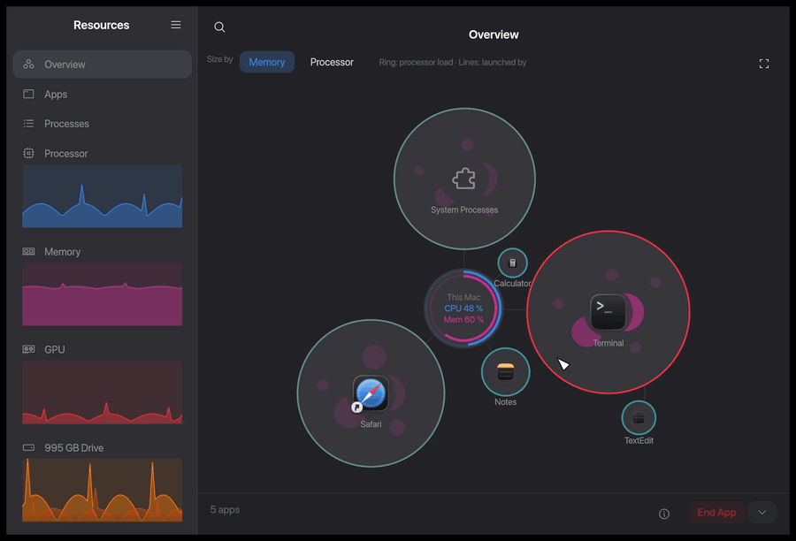

- **Overview** (main page): every app as a bubble around "This Mac" (processor and memory rings), sized by memory or processor, its processes packed inside, ring coloured by load; lines show which app launched which. Pan, pinch to zoom, double-click a bubble for that app's process tree; End / Kill / Halt / Continue from the bottom bar
- **Menu bar:** chosen stats (`CPU 23% · MEM 61%`) with a menu of all current values; closing the window keeps Resources running there
- **Desktop widget:** a small window below your other windows with live graphs of chosen stats; drag it anywhere
- **Settings:** pick the stats for the menu bar and the widget, with suggestions based on what your Mac is doing right now
- **Apps:** running apps with their Dock icons and combined CPU and memory across their processes; a System Processes row for the rest; End / Kill / Halt / Continue
- **Processes:** searchable, sortable list with app icons; End (SIGTERM) / Kill (SIGKILL) / Halt (SIGSTOP) / Continue (SIGCONT)
- **Processor:** total and per-core usage
- **Memory:** RAM and swap
- **GPU:** Apple Silicon usage and memory in use
- **Drives:** one entry per drive with read/write speed and totals
- **Network:** one entry per connection (Wi-Fi, Ethernet); system VPN tunnels merged into one entry
- **Battery:** charge, power draw, health, design capacity, cycle count

The GPU and Battery pages appear only on Macs that report them.

## Screenshots

| | |
|---|---|
| 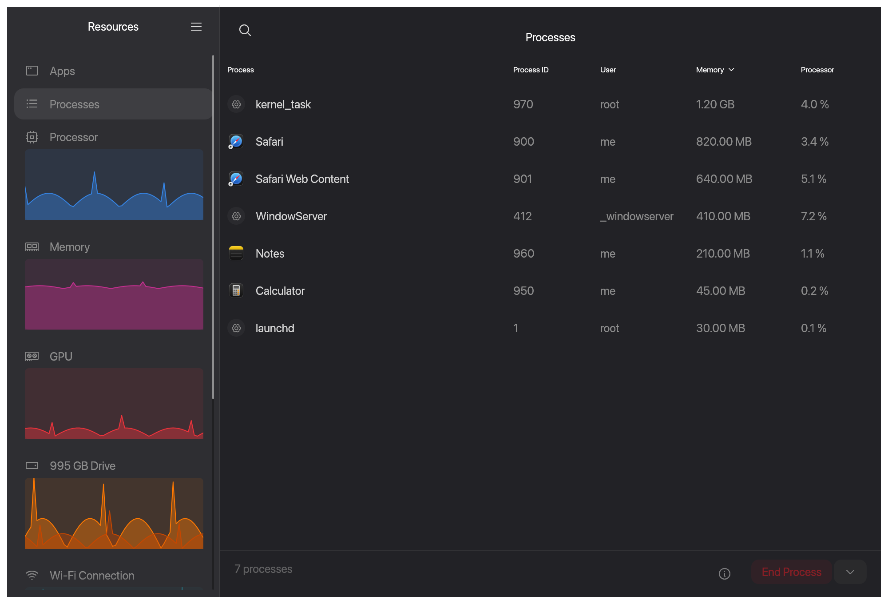 | 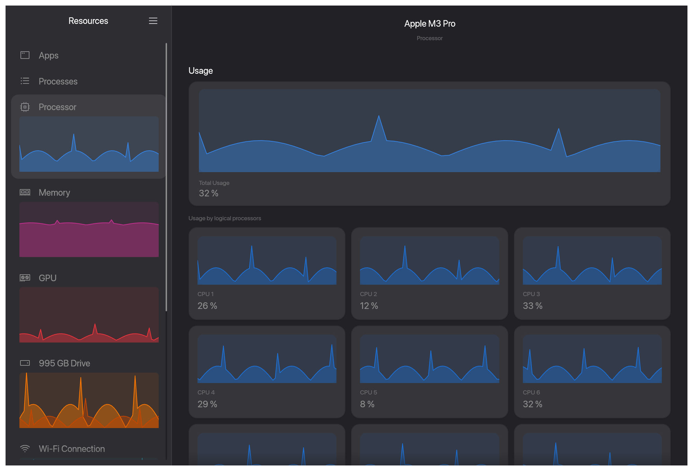 |
| 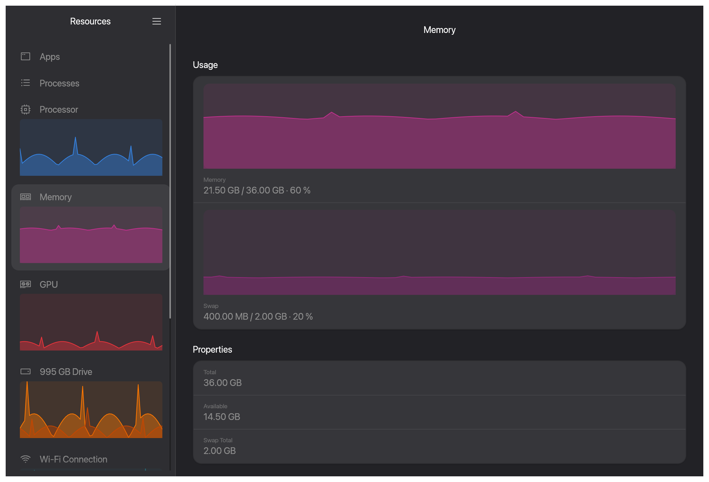 | 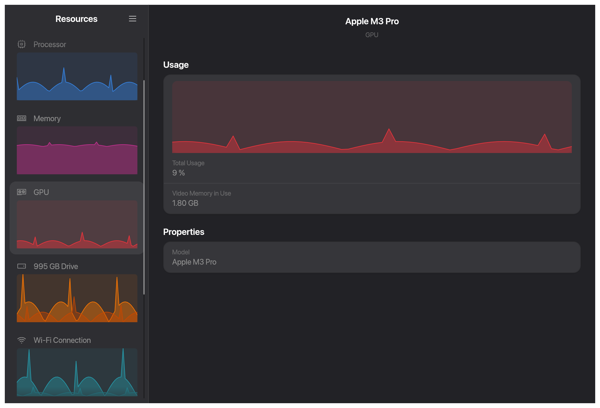 |
| 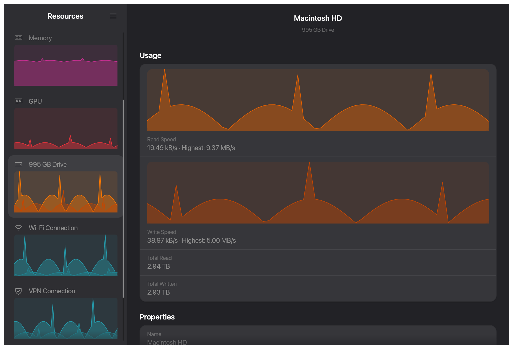 | 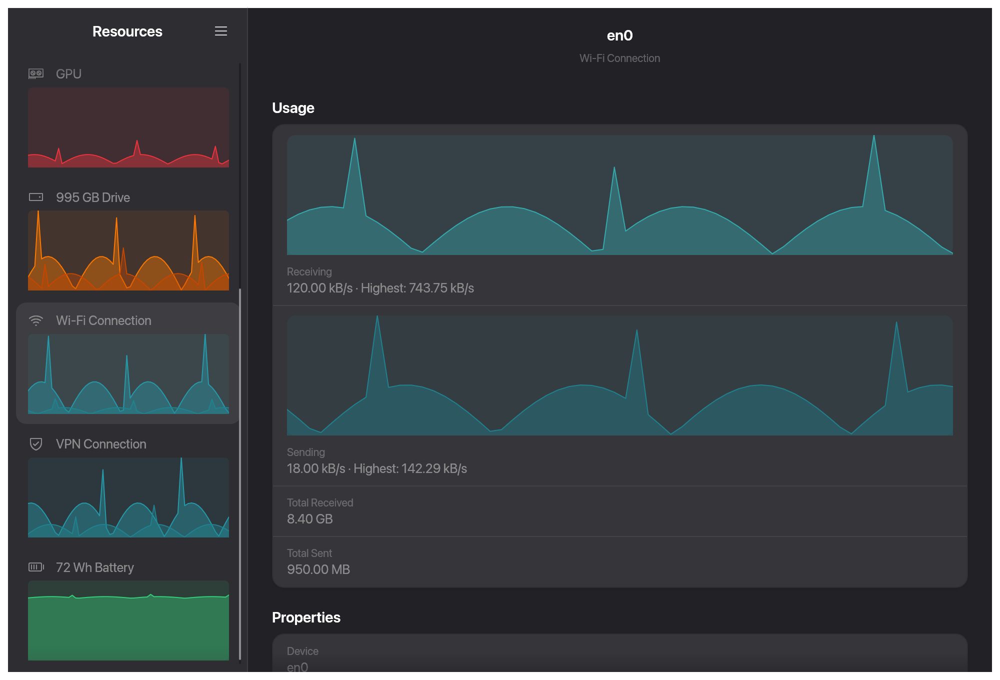 |
| 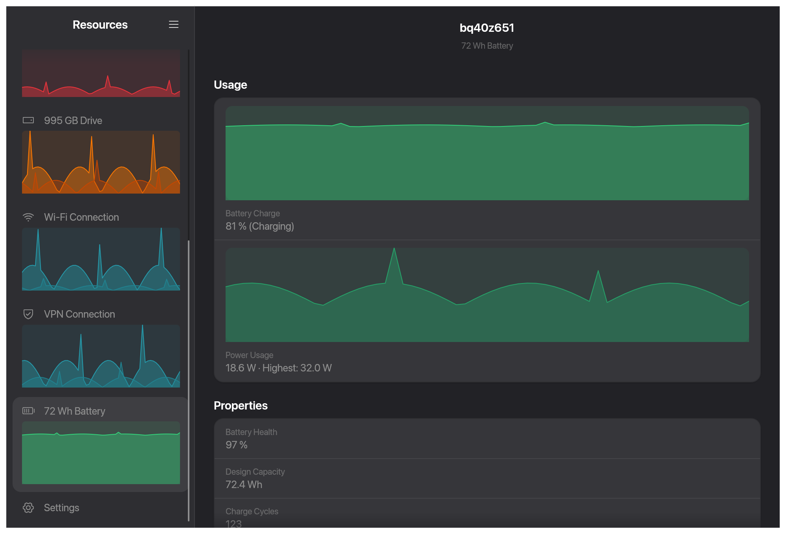 | 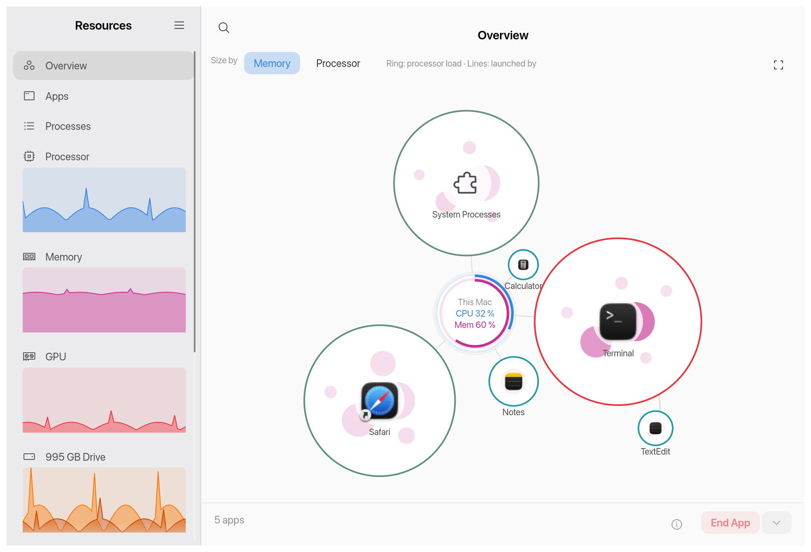 |
| 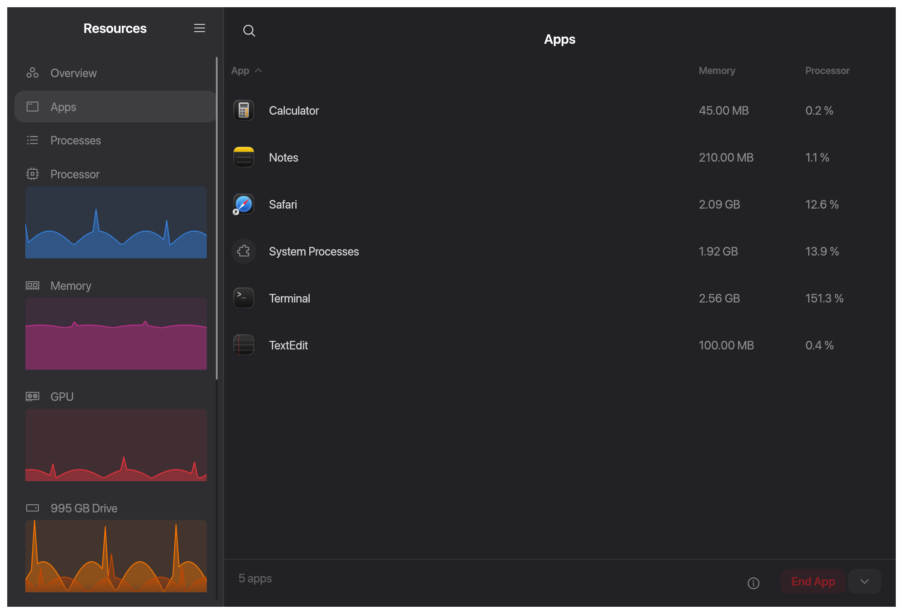 | 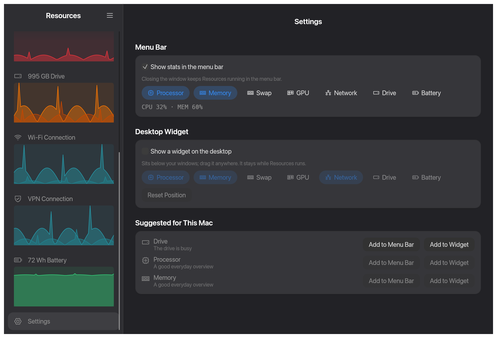 |

Every page in light and dark mode is in [`docs/screenshots/`](docs/screenshots). They are rendered from sample data with `cargo test --test screenshots -- --ignored`, so re-running it updates them after UI changes.

## Install

```sh
brew install --cask VachaganGrigoryan/tap/resources-mac
```

Or download the `.dmg` from [Releases](https://github.com/VachaganGrigoryan/resources-mac/releases) and drag **Resources** to Applications.

Requires macOS 13 or later. The app is universal (Apple Silicon and Intel).

**First launch:** releases are not notarized, so macOS blocks the app the first time. Open **System Settings → Privacy & Security**, scroll down and click **Open Anyway**. Alternatively, run:

```sh
xattr -dr com.apple.quarantine /Applications/Resources.app
```

## Build from source

```sh
cargo run --release
```

Quality gate (same as CI):

```sh
cargo fmt --check && cargo clippy --all-targets --all-features -- -D warnings && cargo test
```

The app icon is drawn in code; to regenerate `macos/AppIcon.icns` and the PNGs after changing `scripts/icon.swift`:

```sh
swift scripts/icon.swift
```

To regenerate the screenshots in `docs/screenshots/` (every page, light and dark, from sample data) and the demo frames in `target/demo/`:

```sh
cargo test --test screenshots -- --ignored
```

Encode the demo frames into `docs/screenrecord/` (mp4 for the website, GIF for this README):

```sh
ffmpeg -framerate 15 -i target/demo/%04d.png -vf scale=1200:-2 -c:v libx264 -pix_fmt yuv420p -movflags +faststart docs/screenrecord/resources-mac-demo.mp4
ffmpeg -framerate 15 -i target/demo/%04d.png -vf "fps=12,scale=900:-1:flags=lanczos,split[a][b];[a]palettegen[p];[b][p]paletteuse" docs/screenrecord/resources-mac-demo.gif
```

To build the universal `.app` and `.dmg` locally:

```sh
rustup target add aarch64-apple-darwin x86_64-apple-darwin
cargo build --release --target aarch64-apple-darwin
cargo build --release --target x86_64-apple-darwin
scripts/bundle.sh 0.1.0   # → dist/Resources.app, dist/resources-mac-0.1.0.dmg
```

## Releasing

1. Bump `version` in `Cargo.toml` and commit.
2. `git tag v0.1.0 && git push --tags`.
3. The **Release** workflow builds the universal dmg, attaches it to a draft GitHub release and updates the cask in [`homebrew-tap`](https://github.com/VachaganGrigoryan/homebrew-tap). This needs the repository secret `HOMEBREW_TAP_DEPLOY_KEY`: the private half of an SSH deploy key that has write access to `homebrew-tap` only.
4. Publish the draft release. The cask URL works only after the release is published.

## Website

The project page ([resources.vachagan.dev](https://resources.vachagan.dev)) lives in [`site/`](site): a small Rust (axum) server for `site/static/` plus the screenshots in `docs/`. Preview it with `docker build -f site/Dockerfile -t resources-site . && docker run --rm -p 8080:8080 resources-site`. Vercel deploys `site/static/` and the screenshots from `main` as static files (see `vercel.json`). A self-hosted copy also runs on the home server: after CI passes, `.github/workflows/deploy-site.yml` deploys it with `deploy/zimaos/compose.yaml`.

## Limitations

- Processes owned by other users (e.g. root) can't be ended. The app does not ask for administrator rights.
- GPU statistics come from undocumented IOKit keys and may change in future macOS versions.

## Credits and license

Inspired by [GNOME Resources](https://gitlab.gnome.org/GNOME/Incubator/resources) by nokyan and contributors. This is an independent project: it is not affiliated with or endorsed by GNOME, and is written from scratch (only the graph colour values and page layout follow GNOME Resources). Mac and macOS are trademarks of Apple Inc.

Icons: [Phosphor](https://phosphoricons.com/) (MIT, see `assets/fonts/Phosphor-LICENSE`).

Licensed under the [Apache License 2.0](LICENSE); see [NOTICE](NOTICE) for bundled third-party works. Release builds also carry `THIRD_PARTY_LICENSES.html` with the license of every compiled-in crate (`cargo about generate about.hbs` produces it). Releases up to and including 0.3.0 were published under GPL-3.0-or-later.

Contributions are welcome, see [CONTRIBUTING.md](CONTRIBUTING.md).
